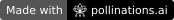
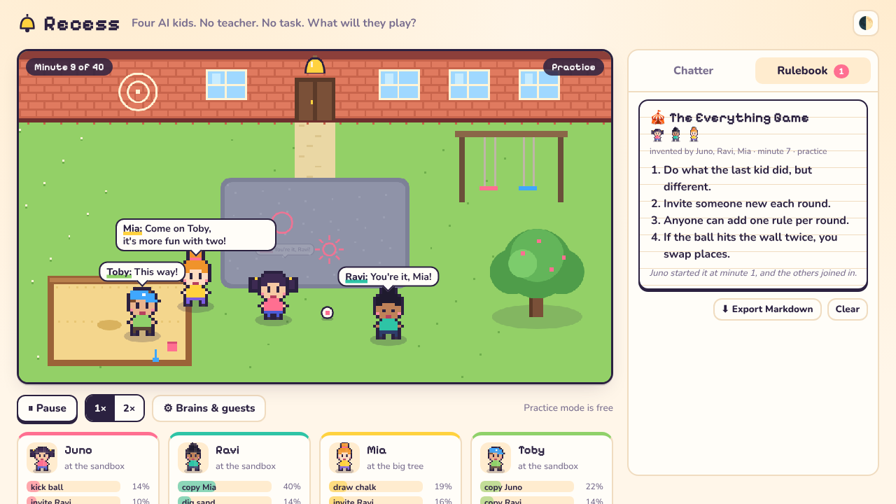

# 🔔 Recess

[](https://pollinations.ai)

**Four AI kids. No teacher. No task. What will they play?**

Juno, Ravi, Mia and Toby are left alone on a playground with a ball, chalk, a sandbox, swings and a big tree. Nobody tells them what to do. Each minute a decision model picks what every kid does next, and they can even build new places that grow the playground. When they start to *play* (following rules nobody required, taking turns, repeating something together) Recess notices, and the game they invented is written into your **Rulebook**.

▶ **Play:** https://notsointresting.github.io/recess/



Inspired by [“Is this machine playing?”](https://arxiv.org/abs/2610.07130), a study of what AI agents do when they are left alone with nothing they have to do.

## How it works

1. **Decide.** A Pollinations decision model gets the playground state and answers, for every kid, which of 21 actions they take next, with a probability for each option. The cards under the playground show what each kid *almost* did.
2. **Act.** A small engine applies the actions: the ball flies, chalk drawings and sand castles stay where they were made, invitations are accepted or ignored.
3. **Talk.** A fast text model writes one line per kid. A kid who chose *make up a rule* has to say the rule, and it joins the playground's rules.
4. **Spot play.** Code counts the signs of play from the paper (repetition, turn-taking, playing together, self-made rules). When two or more appear, a behaviour-scoring model reads the transcript and confirms it.
5. **Write it down.** A writing model names the game and records its rules from what the kids actually did and said.
6. **Grow the world.** A kid can choose to *build*. A text model invents the new place (a Dragon Cave, a Moon Base…) with three things to do there, an image model paints it as pixel art, and the playground expands. Every kid can now go there, and the world is saved for your next recess.

## Models

| Job | Model |
|---|---|
| What each kid does | `microsoft/microsoft-decision-1` (selectable: Jev, Perplexity Decider, Kev 4B, GPT-6 Luna Decisions) |
| What each kid says | `openai/gpt-5-nano` |
| Is this play? | `respan/span-01-lite` |
| Rulebook entries and new places | `openai/gpt-6-luna` |
| Painting new places | `black-forest-labs/flux.2-klein-4b` |

A 40-minute recess costs the visitor about 0.03–0.08 Pollen, depending on how much they build. Microsoft Decision 1 works with Quest Pollen; the other decision models need paid Pollen.

## Bring your own Pollen

Visitors press **Connect** and authorize Recess through [Pollinations Connect](https://github.com/pollinations/pollinations/blob/main/BRING_YOUR_OWN_POLLEN.md). Every request is paid from their own Pollen, within the budget they approve. Without connecting, a small built-in practice brain runs the kids for free.

## Let your own agent play

Open **Brains & guests**, pick a kid and enter any Pollinations model or published agent id. That kid becomes a guest player. See [agents.md](agents.md) for the state your agent receives and the actions it can answer with.

## Run it locally

No build step:

```bash
python3 -m http.server 8000
```

Then open http://localhost:8000.

## License

MIT
